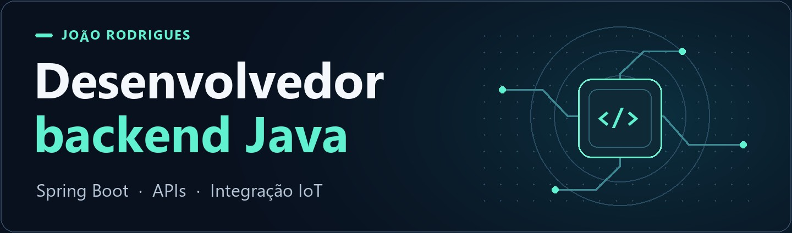
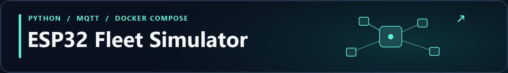

## Projetos em destaque

Simulador de dispositivos ESP32 para testar aplicações MQTT. Publica leituras sintéticas e sinais de presença para um dispositivo ou uma frota.

 · [Versões publicadas](https://github.com/joaorodrigues12/esp32-fleet-simulator-mqtt/releases)

Ver cenários e testes

- Sementes fixas permitem reproduzir sequências de leituras.
- Cada dispositivo virtual mantém sua própria conexão e sessão MQTT.
- A integração contínua roda em Windows e Ubuntu.

<a href="https://github.com/joaorodrigues12/todo-cli"><picture><source media="(prefers-reduced-motion: reduce)" srcset="./assets/projeto-todo.jpg"></picture></a>

Gerenciador de tarefas no terminal para cadastrar, listar, concluir e filtrar tarefas, com persistência em JSON local.

Ver arquitetura e testes

- O domínio usa records imutáveis e os comandos usam sealed interfaces.
- O serviço de tarefas depende de uma interface de repositório. Isso permite testar as regras sem gravar arquivos.
- O Maven executa os testes com `mvn verify`. [Histórico de integração contínua](https://github.com/joaorodrigues12/todo-cli/actions/workflows/ci.yml)

Projeto acadêmico de um aplicativo móvel que reúne notícias financeiras e usa IA para gerar resumos e analisar o sentimento das notícias.

## Ferramentas

**Java · Spring Boot** · Python · MQTT · Docker Compose · GitHub Actions

Sobre meu foco em backend

Estudo Engenharia de Software e compartilho projetos de APIs, ferramentas de terminal e integração com dispositivos IoT. Tenho interesse em modelagem de domínio, testes automatizados e documentação que ajude a rodar o projeto.

[LinkedIn](https://www.linkedin.com/in/jo%C3%A3o-pedro-rodrigues-alves-1592b9255/) · [Todos os repositórios](https://github.com/joaorodrigues12?tab=repositories)
